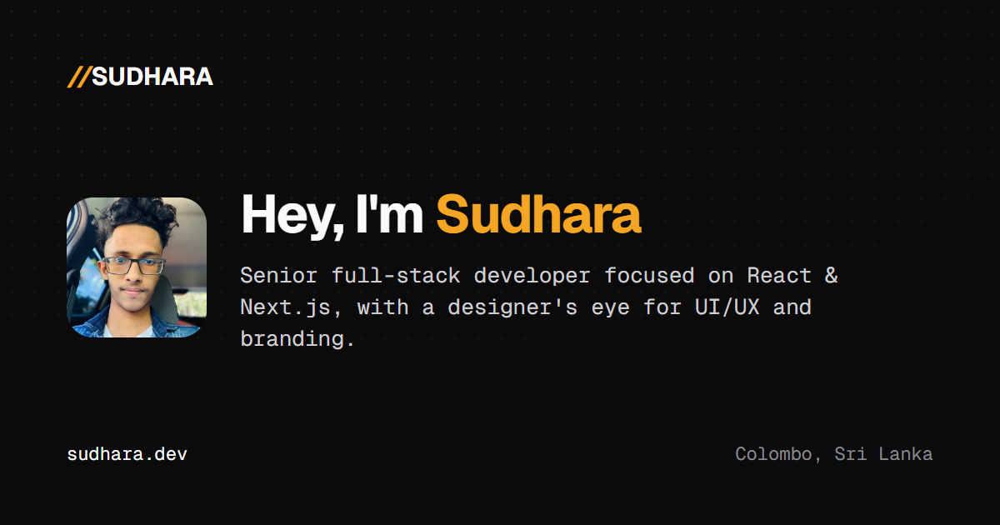

<h3 align="center">Hey, I'm Sudhara 👋</h3>

  Senior full-stack developer focused on <b>React</b> &amp; <b>Next.js</b>, with a designer's eye for UI/UX and branding. 
  Founder &amp; Tech Lead building products with teams in Sri Lanka and the UK.

  
  
  

---

### 🚀 What I do

- **Full-stack web apps** — React, Next.js and Node.js, from the database to a polished, animated UI
- **UI/UX & branding** — interfaces, design systems and brand identities in Figma, Sketch and Adobe
- **Infrastructure** — Linux servers, Docker and cloud deployments on AWS and Google Cloud
- **Leading teams** — taking products from idea to launch as founder and tech lead

### 🏢 Currently leading

| Company | Role |
|---|---|
| **Frinobit (Pvt) Ltd** | Founder · Tech Lead |
| **Konact (Pvt) Ltd** | Founder · Tech Lead |
| **Outstree Limited** (UK) | Founder · Tech Lead |

### 🧰 Tech stack

**Frontend** 
&nbsp;
&nbsp;
&nbsp;
&nbsp;
&nbsp;
&nbsp;

**Backend & cloud** 
&nbsp;
&nbsp;
&nbsp;
&nbsp;
&nbsp;
&nbsp;
&nbsp;

**CMS & commerce** 
&nbsp;
&nbsp;
&nbsp;

**Design** 
&nbsp;
&nbsp;
&nbsp;
&nbsp;

### 📦 Featured project

<table>
  <tr>
    <td width="64" align="center"></td>
    <td><a href="https://ledgerr.co"><b>Ledgerr</b></a> — The trading, in one place! ledgerr.co</td>
  </tr>
</table>

### 🎓 Education

- 💻 **Software Engineering** — ESOFT Metro Campus
- ✨ **Digital Marketing** — Asia Pacific Institute of Digital Marketing (APIDM)
- 🤖 **AI Engineering & Frontend Development** — Scrimba

### 📬 Let's connect

&nbsp;&nbsp;
&nbsp;&nbsp;
&nbsp;&nbsp;
&nbsp;&nbsp;
&nbsp;&nbsp;
&nbsp;&nbsp;

Full profile at <a href="https://sudhara.dev">sudhara.dev</a>
