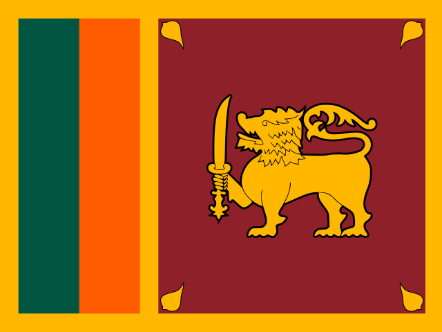

<!--
  GitHub profile README for Sudhara (github.com/sudharadev).
  Lives in the public repo sudharadev/sudharadev together with the website
  (index.html) that GitHub Pages serves at https://sudhara.dev — see DEPLOY.md.
  Icons are loaded from the icons/ folder in this same repo.
-->

### Hey, I'm Sudhara! 👋

`Senior full-stack developer focused on React & Next.js, with a designer's eye for UI/UX and branding. Based in Colombo, Sri Lanka` 

  
  

🟢 `Available for new projects, let's talk!`

---

#### TECH STACK
`The tech stack I use for my personal and client work:`

 React &nbsp;
 Node.js &nbsp;
 Next.js &nbsp;
 TypeScript &nbsp;
 JavaScript &nbsp;
 Vite &nbsp;
 Tailwind CSS &nbsp;
 AWS &nbsp;
 Google Cloud &nbsp;
 Docker &nbsp;
 Ubuntu &nbsp;
 Vanilla HTML/CSS &nbsp;
 WordPress &nbsp;
 PHP &nbsp;
 Shopify &nbsp;
 Liquid &nbsp;
 Webflow

#### DESIGN TOOLS
`For UI/UX design:` &nbsp;
 Figma &nbsp;
 Sketch

`For branding:` &nbsp;
 Photoshop &nbsp;
 Illustrator &nbsp;
 Procreate

#### PROJECTS
`Products I have designed and built:`

| | Project | Status | About |
|:-:|---|:-:|---|
|  | [**Ledgerr**](https://ledgerr.co) |  | The trading, in one place! |

#### FIND ME ON

<a href="https://github.com/sudharadev"> GitHub</a> &nbsp;
<a href="https://www.linkedin.com/in/sudharadev"> LinkedIn</a> &nbsp;
<a href="https://www.facebook.com/sudharadev"> Facebook</a> &nbsp;
<a href="https://www.instagram.com/sudharadev"> Instagram</a> &nbsp;
 Discord: `sudharadev`

#### GET IN TOUCH
`You can reach me anytime at` **[hello@sudhara.dev](mailto:hello@sudhara.dev)**

Built with ♥ by Sudhara · <a href="https://sudhara.dev">sudhara.dev</a>
