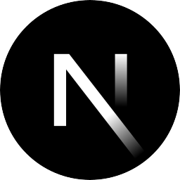
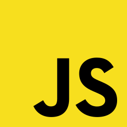
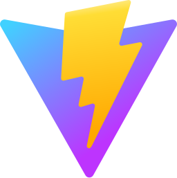
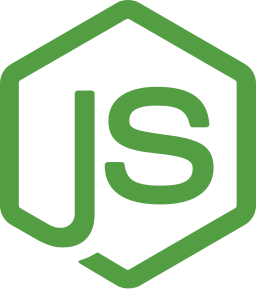
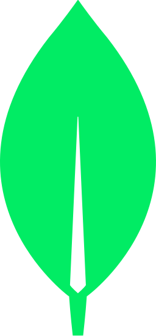
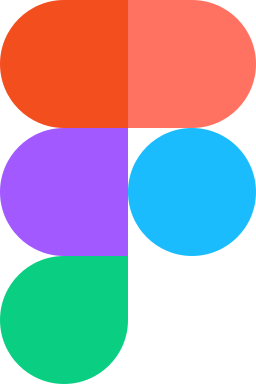
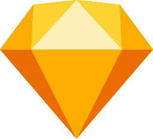
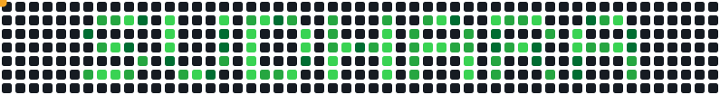

<a href="https://sudhara.dev">
  <picture>
    <source media="(prefers-color-scheme: dark)" srcset="assets/hero-dark.svg?v=3" />
    <source media="(prefers-color-scheme: light)" srcset="assets/hero-light.svg?v=3" />
    
  </picture>
</a>

<br/>
<br/>

<p align="center">
  <a href="https://sudhara.dev"></a>
  <a href="https://wa.me/94757817059"></a>
  <a href="mailto:hello@sudhara.dev"></a>
  <a href="https://www.linkedin.com/in/sudharadev"></a>
</p>

I build web products end to end: the database, the API, the interface and the brand around it. Mostly **React** and **Next.js** on the front, **Node.js** behind it, deployed on servers I set up myself. I also design, so what ships looks the way it was meant to.

```ts
const sudhara = {
  based:    "Colombo, Sri Lanka (UTC+5:30)",
  focus:    ["React", "Next.js", "Node.js", "UI/UX", "Branding"],
  openTo:   ["freelance", "remote", "interesting problems"],
};
```

## Stack

&nbsp;
&nbsp;
&nbsp;
&nbsp;
&nbsp;
&nbsp;
&nbsp;
&nbsp;
&nbsp;
&nbsp;
&nbsp;
&nbsp;
&nbsp;
&nbsp;
&nbsp;
&nbsp;
&nbsp;
&nbsp;
&nbsp;
&nbsp;
&nbsp;
&nbsp;
&nbsp;


## Snack break

<picture>
  <source media="(prefers-color-scheme: dark)" srcset="assets/snake-dark.svg" />
  <source media="(prefers-color-scheme: light)" srcset="assets/snake-light.svg" />
  
</picture>

## Education

- **Software Engineering**, ESOFT Metro Campus
- **Digital Marketing**, Asia Pacific Institute of Digital Marketing (APIDM)
- **AI Engineering & Frontend Development**, Scrimba

## Let's talk

Have a product to build or a brand to shape? The fastest way to reach me is [WhatsApp](https://wa.me/94757817059) or [hello@sudhara.dev](mailto:hello@sudhara.dev).

<a href="https://wa.me/94757817059"></a>&nbsp;&nbsp;
<a href="https://t.me/sudharadev"></a>&nbsp;&nbsp;
&nbsp;&nbsp;
<a href="https://www.linkedin.com/in/sudharadev"></a>&nbsp;&nbsp;
<a href="https://www.instagram.com/sudharadev"></a>&nbsp;&nbsp;
<a href="https://www.facebook.com/sudharadev"></a>
